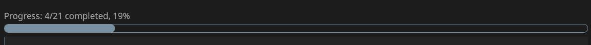
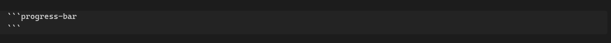
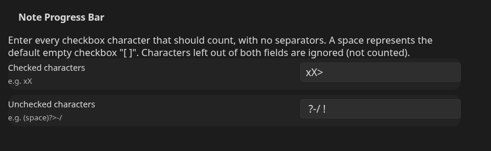

# Note Progress Bar

An Obsidian plugin that shows a progress bar for the checkboxes in the current note.

There are settings to tell the plugin what sort of checkboxes are considered complete.

## Usage

Add a code block with the language `progress-bar` anywhere in a note:

The block renders as a bar with a label such as "Progress: 3/5 completed, 60%". It counts every checkbox in the note and updates as you edit.

## Settings

- **Checked characters**: default `xX`
- **Unchecked characters**: default a space plus `?>-/`

Enter the characters with no separators. A checkbox whose character appears in neither field is ignored and not counted.

I use extended checkboxes via a CSS snippet and, for example, I consider a "forwarded" checkbox to be "complete". My settings are shown below.

## Installation

Install from Settings > Community plugins once the plugin is listed. To install manually, download `main.js`, `manifest.json` and `styles.css` from the latest release and place them in `<vault>/.obsidian/plugins/note-progress-bar/`.

## Licence

MIT
